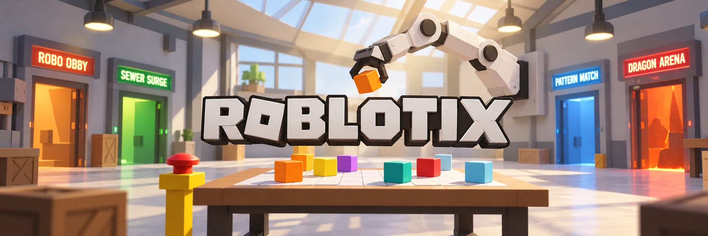

<p align="center">
  
</p>

<p align="center">
  
  
  
  
  
  
  
</p>

## What it is

Roblotix is a Roblox arcade you play with a real robot arm.

One person drives a real SO-101 arm and moves foam cubes around a printed grid on a table.
An overhead camera watches the table. What happens on the table shows up live inside Roblox,
and what happens in Roblox is sent back to the arm.

The lobby is a robotics workshop with four game bays:

| Game | What you do |
|---|---|
| Robo Obby | The arm places blocks so a player can cross a course |
| Sewer Surge | Water rises and players climb while the arm builds the way up |
| Pattern Match | Orders arrive as tickets and the arm builds the pattern before time runs out |
| Dragon Arena | The arm is a dragon and up to 12 players dodge it. |

## What you need

Hardware:

- An SO-101 leader arm and an SO-101 follower arm
- A USB camera mounted above the table
- The printed grid sheet and foam cubes in orange, yellow, purple, teal, red and light blue

Software:

- Python 3.12 in a LeRobot virtual environment at `~/lerobot/.venv`
- Roblox Studio
- An OpenAI API key, used to read the board

## Getting started

**1. Add your API key.**

Make a file called `.env` in the repo root:

```
OPENAI_API_KEY=sk-your-key-here
```

**2. Calibrate the arm.**

Run these from the repo root. Torque stays off for both, so you move the arm by hand.

```bash
python -m robot.scripts.calibration.touch_calibrate    # about 2 minutes
python -m robot.scripts.calibration.auto_calibrate     # about 10 minutes
```

Run `touch_calibrate` again any time you move the arm or the sheet. Always run
`auto_calibrate` after it.

**3. Tune the camera.**

```bash
./run camera
```

This opens a web page where you set exposure and white balance until the six cube colours
look different from each other. Do this again every time you move the rig, because it depends
on the light in the room.

**4. Start the bridge.**

```bash
./run teleop --vision
```

The leader arm now drives the follower arm, and the camera reads the board.

**5. Open the game.**

Open `places/LeBot_Arcade.rbxl` in Roblox Studio. Turn on
**Game Settings > Security > Allow HTTP Requests**, then press Play. Studio connects to
`ws://localhost:8765`.

You can also open `http://localhost:8766` to see the table in a browser.

## Other commands

```bash
./run follower      # real arm, torque off, move it by hand
./run camera        # tune exposure and white balance
./run stop          # free the ports
```

Press space in the terminal to clear every active effect. Press `q` or Ctrl-C to quit. The
12V barrel jack is the hard stop.

## Where things live

| Folder | What is in it |
|---|---|
| `bridge/` | Sends the arm and table state to Roblox, and events back |
| `robot/` | Everything that touches the arm or the camera |
| `roblox/` | The Roblox source for the arcade and the games |
| `places/` | The Roblox place file |
| `docs/` | Plans for the arcade and each game |
| `PROTOCOL.md` | The wire format between the robot and Roblox |

## Demo

<p align="center">
  <a href="https://www.youtube.com/watch?v=l9G8ekAVupE">
    
  </a>
</p>
